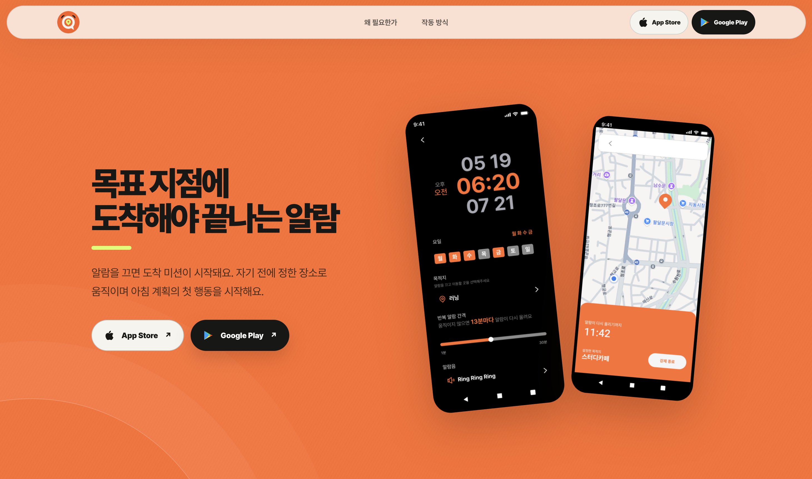
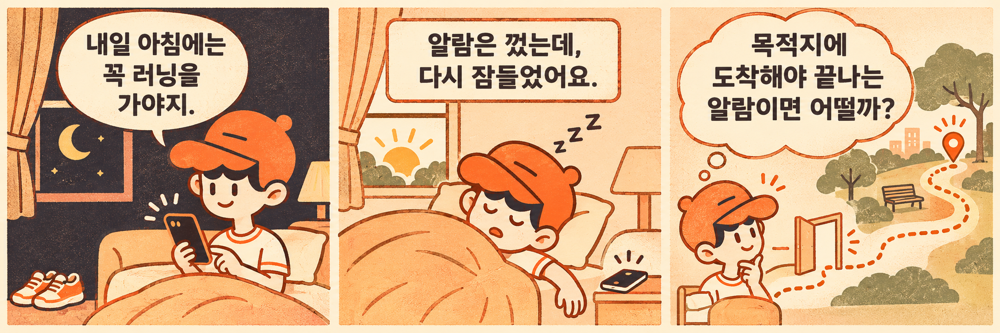
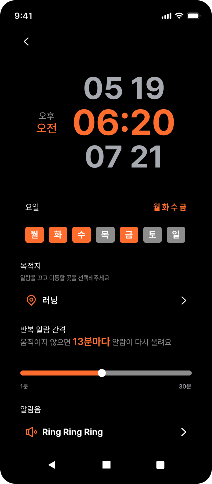
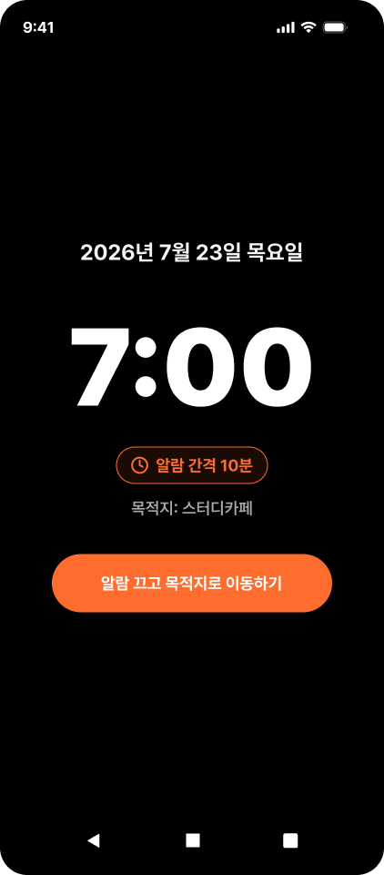
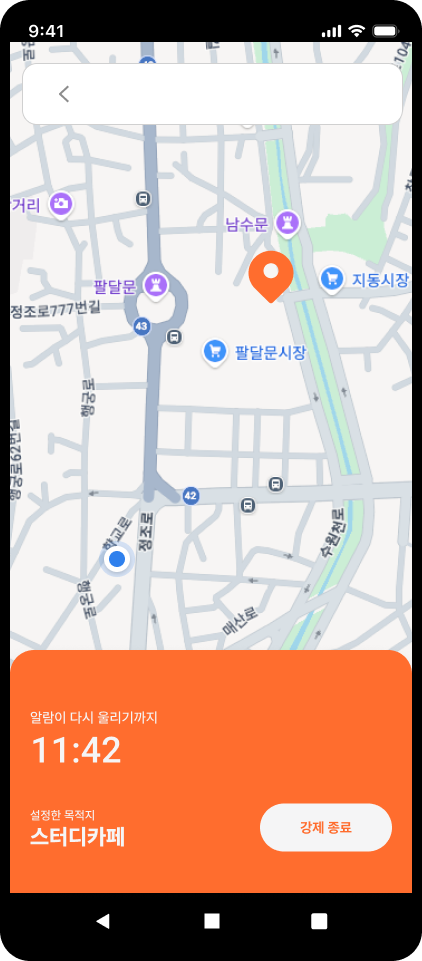
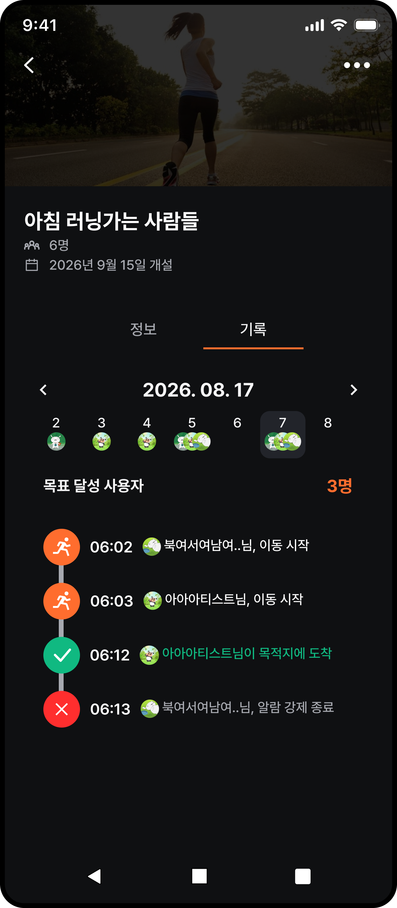
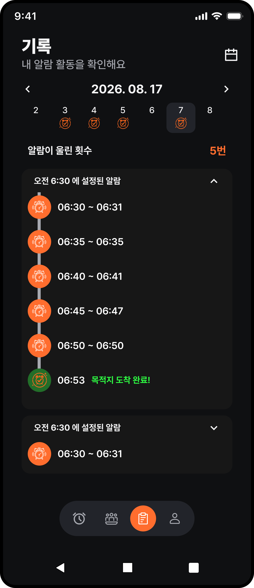
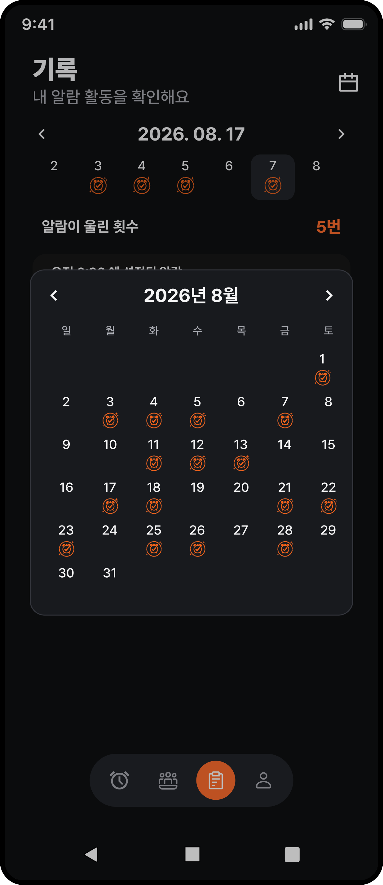

# 링아웃 서비스 이야기 — 초안

> 용도 가정: 프로젝트 소개 페이지·포트폴리오의 ‘서비스 이야기’ 영역.
> 아래 본문은 게시용 문안 초안이다. `[직접 작성]`은 사용자가 채울 내용, `[확인 필요]`는 실제 정책·경험과 맞춰볼 내용, `[그림 위치]`는 추후 넣을 이미지다.
> 기존 자료와 사용자가 제공한 기획 계기·사용 후기를 반영했다. 관찰 결과와 향후 계획(기존 6·7번)은 이번 구성에서 제외했다.

## 1. 서비스 한눈에 보기

### 마음먹은 일을, 실제 출발로 이어주는 알람

운동을 하러 가고, 공부를 시작하고, 약속한 시간에 움직이는 일. 계획은 세웠지만 막상 시간이 되면 시작을 미루곤 합니다.

링아웃은 시간과 목적지를 함께 설정하는 알람 서비스입니다. 알람이 울린 뒤에도 목적지에 도착할 때까지 다시 알려주며, 계획했던 행동을 시작하도록 돕습니다.

**무슨 일이 있어도 시작하게 한다. 링아웃.**

> [그림 위치 01 · 대표 이미지 — 자료 확보]
> - 첨부한 공식 홈페이지 첫 화면을 대표 이미지로 사용.
> - 주황색 배경과 “목표 지점에 도착해야 끝나는 알람” 문구, 휴대폰 목업을 중심으로 배치.
> - 웹페이지에 적용할 때는 본문과 문구가 중복되지 않도록 이미지 크기·배치를 조정.

`[직접 작성]` 서비스 링크: 앱스토어 / 플레이스토어 / 랜딩 페이지 중 공개할 링크.

## 2. 우리가 풀고 싶었던 문제

### 알람을 껐다고, 계획을 시작한 것은 아니니까

링아웃은 호이의 아침 러닝 고민에서 시작됐어요.

> 호이의 경험을 바탕으로 재구성

알람을 끄는 것에서 끝나지 않고, 집 밖으로 나와 목적지까지 가도록. 그렇게 링아웃을 만들었어요.

### 같은 고민을 가진 팀원이 직접 사용했어요

이 문제에 공감한 팀원 ‘아티’는 한 달 이상 링아웃을 직접 사용했습니다.

> “아침에 알람을 8개씩 맞추고도 못 일어나는 편인데, 끝까지 울려줘서 좋아요!”
>
> — 아티 · 링아웃 팀원 / 한 달 이상 실사용

> [그림 위치 02 · 아티와 호이의 대화창]
> - 하나의 대화창에서 아티의 메시지는 왼쪽 위에, 호이의 메시지는 오른쪽 아래에 배치. 캐리커처는 각 말풍선 바깥에 두고 꼬리를 캐리커처 쪽으로 향하게 함.
> - 아티의 캐리커처(`assets/arti-caricature.png`)와 실제 후기 말풍선을 배치.
> - 이름 옆에는 ‘링아웃 팀원 · 한 달 이상 실사용’을 표시하고, 말풍선의 핵심 문구에 주황색으로 강조.

## 3. 링아웃의 해결 방식

### 알람의 끝을, 목적지 도착으로

링아웃에서는 가려는 장소와 시간을 미리 정합니다. 약속한 시간이 되면 알람이 울리고, 목적지에 도착하기 전까지 설정한 간격에 따라 다시 알려줍니다.

우리가 만들고 싶었던 것은 계획을 한 번 더 적는 도구가 아니라, 계획한 순간에 움직일 계기를 주는 서비스였습니다. 그래서 핵심 사용 흐름을 ‘목적지 설정 → 알람 → 이동 → 도착’으로 구성했습니다.

`[확인 필요]` “도착할 때까지 다시 알려준다”는 표현을 현재 출시 버전의 재울림·강제 종료·시간 제한 정책과 맞춰 주세요. “절대 끌 수 없다” 같은 표현은 사용하지 않습니다.

### 오늘 밤의 계획이 내일 아침의 첫 행동으로.

실제 앱 화면을 따라 링아웃의 하루를 만나보세요.

> [섹션 위치 03 · 랜딩페이지의 앱 체험 섹션 전체 유지]
> - 원본: `service.js`의 `.app-experience`.
> - 상단 문구: **FROM PLAN TO ACTION**.
> - 문구만 사용하는 것이 아니라 아래 6단계의 화면·제목·설명을 모두 포함.
> - 기존의 단계 선택 버튼, 휴대폰 화면, 진행 표시(01 / 06), RINGOUT APP 표기, 화면 아래 캡션, 이전·다음 버튼, 현재 단계 점 표시를 그대로 유지.
> - 단계 선택 시 해당 이미지·캡션·진행 표시가 함께 바뀌는 동작과 화면 전환 효과도 유지.
> - 씨앗이를 눌렀을 때 현재 화면을 강조하고 설명하는 안내, ‘다음 앱 화면’ 버튼과 스크롤·터치로 단계를 넘기는 동작도 기존 구현 유지.
> - 아래는 실제 구현에 있는 문구와 이미지의 기록. 실제 페이지에서는 6장을 연속 나열하지 않고 기존 섹션처럼 한 단계씩 표시.

#### 01. 내일의 계획

**시간과 목적지를 함께 정해요.**

알람 시간, 목표 지점, 제한 시간을 내일의 계획에 맞게 설정해요.

> 씨앗이 안내: 먼저 내일 아침 어디로 갈지 정해보자. 시간과 목적지가 하나의 약속이 되는 거야.

#### 02. 아침의 시작

**알람을 끄면, 다음 행동이 시작돼요.**

울림을 멈추는 데서 끝나지 않도록. 알람을 끈 뒤에는 목표 지점으로 이동하는 미션이 이어져요.

> 씨앗이 안내: 눈을 떴다면 이제 출발할 차례! 알람을 끄는 순간부터 도착 미션으로 이어져.

#### 03. 목표 지점으로

**계획했던 장소로 움직여요.**

지도에서 목표 지점을 확인하고, 설정한 시간 안에 도착하는 첫 행동을 시작해요.

> 씨앗이 안내: 여기가 오늘의 목적지야. 지도와 남은 시간을 보면서 첫 행동을 이어가봐.

#### 04. 함께하는 실천

**서로의 출발과 도착을 확인해요.**

같은 목표를 가진 모임에서 누가 출발하고 도착했는지 살펴봐요. 함께 실천하는 경험을 만들어요.

> 씨앗이 안내: 혼자만의 약속을 함께하는 실천으로. 모임에서는 서로의 출발과 도착을 볼 수 있어.

#### 05. 하루의 기록

**알람부터 도착까지 돌아봐요.**

알람이 울린 횟수와 시간, 목적지에 도착한 시각을 하루의 활동 내역에서 확인해요.

> 씨앗이 안내: 오늘의 첫 행동이 기록으로 남았네. 알람이 울린 순간부터 도착까지 돌아볼 수 있어.

#### 06. 쌓이는 아침

**한 달의 실천을 한눈에 봐요.**

활동한 날짜를 달력으로 살펴보며 지난 아침의 기록을 확인해요.

> 씨앗이 안내: 이렇게 하루하루 쌓인 아침을 달력에서 확인할 수 있어. 다음에는 우리의 검증 이야기도 볼까?

> 편집 메모: 이 6단계는 앱 사용 소개이며, 앞서 제외한 기존 문서의 6번 ‘관찰 결과’·7번 ‘향후 계획’과는 별개입니다. 마지막 씨앗이 안내의 ‘검증 이야기’ 연결 문구는 원본 그대로 기록했으며, 최종 페이지의 다음 섹션에 맞춰 추후 조정합니다.

## 4. 실제로는 이렇게 사용해요

### 내일 아침 운동을 시작하고 싶다면

1. 운동하러 갈 장소를 목적지로 정합니다.
2. 출발을 준비할 시간과 반복 알람 간격을 설정합니다.
3. 알람이 울리면 준비를 마치고 목적지로 이동합니다.
4. 목적지에 도착하면 도착을 확인하고 알람을 종료합니다.

운동뿐 아니라 도서관에서 공부를 시작하거나 정해진 장소로 이동해야 할 때도 활용할 수 있습니다.

`[확인 필요]` 위 내용은 사용 예시입니다. 실제 주요 사용 목적은 사용자 조사로 확인한 경우에만 단정해 주세요. 도착 확인이 자동인지, 버튼 조작이 필요한지도 실제 동작에 맞춰 수정해 주세요.

> [영상 위치 04 · 대표 사용 예시 — 인스타그램 릴스]
> - 사용자가 제공한 공식 릴스를 이 위치에 배치.
> - 세로 영상 비율을 유지하고, 옆이나 아래에 위 사용 단계를 짧게 배치.
> - 페이지 제작 시 임베드가 가능하면 영상으로 표시하고, 어려우면 썸네일과 “릴스로 사용 모습 보기” 링크로 연결.
> - 현재 초안에는 링크만 기록했으며 영상의 세부 장면은 확인하지 않음.

[릴스로 사용 모습 보기](https://www.instagram.com/reel/De8mG10Pd_j/)

## 5. 혼자 시작하기 어렵다면, 함께

### 함께하는 약속이 시작을 도울 수 있을까요?

링아웃에는 모임 기능도 있습니다. 개인의 알람 사용을 넘어, 함께하는 환경이 행동의 시작에 어떤 영향을 주는지 살펴보고 있습니다.

**실제로 얼리버드 모임에서는 우테코 크루 21명이 참여하고 있어요 🔥**

`[직접 작성 · 중요]` 모임을 이용하는 실제 방법을 2~3문장으로 채워 주세요.

- 모임을 만들거나 참여한 뒤 사용자는 무엇을 하나요?
- 서로 어떤 정보를 볼 수 있나요? 일정, 도착 여부 등 실제 제공 항목만 적어 주세요.
- 개인 알람과 모임은 어떻게 연결되나요?

`[직접 작성]` 모임을 추가한 계기: 사용자 요청, 팀의 가설, 기존 사용의 어려움 중 실제 근거를 적어 주세요.

> [그림 위치 05 · 함께 사용하는 모습]
> - 모임 상세 화면과 실제 핵심 상호작용 한 장.
> - 모임이 어떤 도움을 주는지 설명할 수 있는 화면을 선택.

---

## 아직 채울 내용과 필요한 자료

1. **모임 경험**: 실제 사용 흐름, 서로 볼 수 있는 정보, 개인 알람과의 연결 방식, 모임을 추가한 계기.
2. **서비스 링크**: 공개할 홈페이지·앱스토어·플레이스토어 주소.
3. **모임 화면 · 선택**: 모임 활동 화면은 확보했습니다. 얼리버드 모임 상세나 21명의 참여가 보이는 화면이 있으면 모임 소개에 추가합니다.
4. **선택 자료**: 도착 완료·알람 종료 화면.

대표 이미지와 앱 체험 섹션의 6개 화면(설정·울림·이동·모임 활동·일별 기록·달력)은 확보했습니다. 별도의 모임 상세 화면은 모임 소개를 보완할 때 추가하면 됩니다. 도착 완료 화면이 있으면 보완할 수 있습니다.

## 이후 편집 메모

- 현재 순서: 서비스 요약 → 호이의 문제와 아티의 사용 경험 → 해결 방식 → 릴스 사용 예시 → 모임.
- 호이의 기획 계기는 3컷 만화로, 아티의 후기는 캐리커처와 말풍선으로 보여줍니다.
- 대표 이미지와 앱 화면은 `assets/`에 원본을 보관.
- 기존 6번 관찰 결과·7번 향후 계획은 이번 초안에서 제외.
- 모임 내용이 채워지면 앞뒤 연결 문장과 전체 분량을 한 번에 다듬기.

## 그림으로 바꿀 부분과 들어갈 문구

> 다음 편집을 위한 구성안입니다. 호이의 3컷 만화를 서비스 소개에 적용했습니다. 없는 그림은 `그림.`으로 표시합니다. 기존 6단계 앱 체험은 전체 유지합니다.

### A. 기획 계기 — 호이의 3컷 이야기

적용 위치: 2번 ‘알람을 껐다고, 계획을 시작한 것은 아니니까’.

도입 문구: **링아웃은 호이의 아침 러닝 고민에서 시작됐어요.**

| 장면 | 그림 장면 설명 | 들어갈 문구 |
| --- | --- | --- |
| 1. 전날 밤 | 러닝을 계획하며 알람을 맞추는 호이 | 내일 아침에는 꼭 러닝을 가야지. |
| 2. 다음 날 아침 | 알람을 끄고 다시 잠든 호이 | 알람은 껐는데, 다시 잠들었어요. |
| 3. 서비스의 출발 | 침대에서 집 밖의 목적지로 이어지는 길 | 목적지에 도착해야 끝나는 알람이면 어떨까? |

마무리 문구: **알람을 끄는 것에서 끝나지 않고, 집 밖으로 나와 목적지까지 가도록. 그렇게 링아웃을 만들었어요.**

편집 메모:

- 장면 문구는 제공된 경험을 바탕으로 재구성한 서술이며, 호이의 실제 발언을 인용한 것으로 표시하지 않습니다.
- 가로 3컷 이미지로 배치했습니다. 모바일 전용 구성은 보류합니다.
- 호이의 기획 계기는 3컷으로 보여주고, 대화창 오른쪽 말풍선에는 짧은 요약을 배치했습니다.
- 아티의 캐리커처와 실제 후기 말풍선은 유지합니다. 이름 옆에는 ‘링아웃 팀원 · 한 달 이상 실사용’을 표시합니다.

### B. 해결 방식 — 알람에서 도착까지의 흐름도

위치: 3번 ‘알람의 끝을, 목적지 도착으로’의 설명 두 문단을 대체. 기존 6단계 앱 체험 바로 앞에 배치합니다.

도입 문구: **시간과 목적지를 정하면, 도착까지 다시 알려줘요.**

그림.

그림 안에 들어갈 순서와 문구:

1. **시간·목적지 설정** — 언제, 어디로 갈지 미리 정해요.
2. **알람 울림** — 알람을 끄고 이동 미션을 시작해요.
3. **목적지로 이동** — 계획했던 장소로 움직여요.
4. **도착·알람 종료** — 목적지에 도착하면 미션을 마쳐요.

이동 단계에 되돌아오는 화살표를 추가하고 **‘도착 전에는 설정한 간격마다 다시 울려요’**라고 표시합니다.

편집 메모:

- 흐름도는 핵심 원리를 한눈에 보여주고, 뒤의 6단계 앱 체험은 실제 화면을 살펴보는 역할로 둡니다.
- 재울림 화살표가 설정부터 모든 단계를 반복한다는 뜻으로 보이지 않게 이동 단계 주변에만 표시합니다.
- 강제 종료·시간 제한이 있는 실제 정책에 맞춰 표현하고, ‘도착 외에는 종료할 수 없다’고 표현하지 않습니다.

### C. 모임 소개 — 기존 화면에 설명 붙이기

위치: 5번 ‘혼자 시작하기 어렵다면, 함께’의 모임 설명과 그림 위치 05.

본문 후보: **같은 목표를 가진 모임에서 서로의 출발과 도착을 확인해요. 함께하는 사람들의 실천을 가까이에서 볼 수 있어요.**

강조 문구: **실제로 얼리버드 모임에서는 우테코 크루 21명이 참여하고 있어요 🔥**

기존 `assets/ringout-group-activity.png`를 사용하고, 화면의 해당 상태 옆에 아래 설명을 연결합니다.

- 출발 상태: **누가 출발했는지 확인해요.**
- 도착 상태: **목적지에 도착한 소식을 함께 봐요.**

편집 메모:

- 설명선은 실제 화면에서 해당 상태가 보이는 위치에 연결합니다.
- 기존 모임 활동 화면이 얼리버드 모임의 실제 화면인지 확인되지 않았다면 ‘모임 활동 화면 예시’로 표시합니다. 21명이 화면에 나타난다고 설명하지 않습니다.
- 화면에서 읽을 수 없는 작은 글씨를 설명 문구로 보완합니다.
- 모임을 추가한 실제 계기는 자료가 채워지면 별도 한 문장으로 넣습니다.

### D. 대표 이미지와 릴스 — 중복 설명 줄이기

- 대표 이미지는 기존 공식 홈페이지 캡처를 사용합니다. 추후 휴대폰 목업 중심으로 잘라 메뉴·다운로드 버튼이 본문에서 반복되지 않게 배치합니다.
- 릴스 영역 제목은 **‘실제 사용 모습도 영상으로 만나보세요’**로 줄일 수 있습니다.
- 릴스 옆의 4단계 목록은 앞의 흐름도·앱 체험과 겹치므로, 그림 구성이 적용되면 생략합니다.
- 릴스 아래에는 **‘운동부터 공부까지, 계획했던 장소로 움직이는 첫걸음.’** 정도의 짧은 문구와 기존 인스타그램 링크를 둡니다. 이는 활용 예시이며 실제 주요 사용 목적을 단정하는 문구로 쓰지 않습니다.
